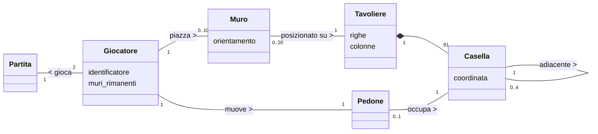
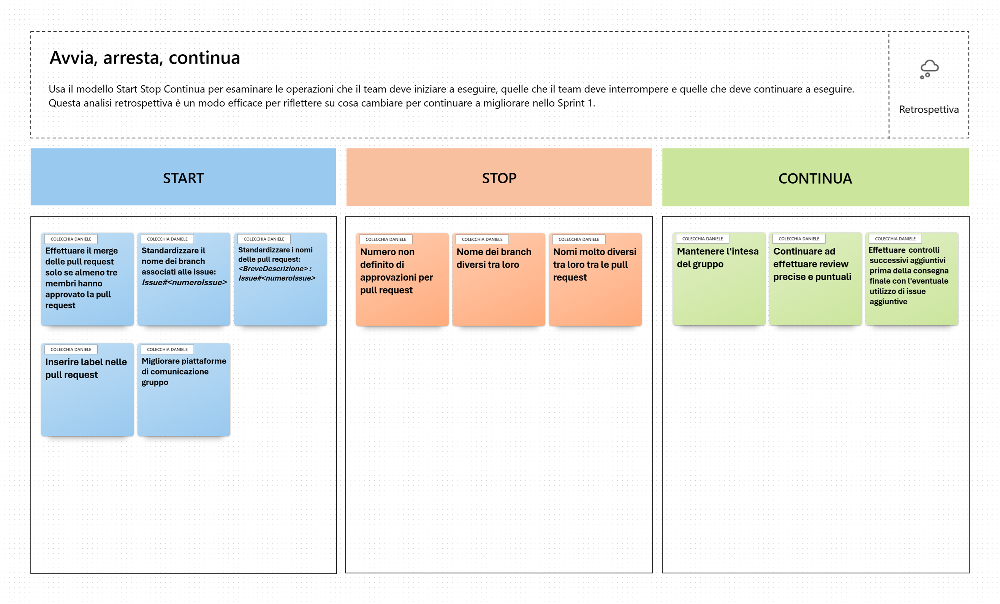

# Relazione Tecnica - Sprint 1 Team Stonebraker 

## 1. Introduzione
Il presente documento descrive il lavoro di analisi, progettazione e sviluppo svolto dal team durante lo Sprint 1 per la realizzazione di una versione digitale del gioco da tavolo Quoridor. Quoridor è un gioco strategico in cui i giocatori (Giocatore 1 e Giocatore 2) si sfidano su una scacchiera 9x9. 

All'inizio della partita, i pedoni vengono posizionati al centro della rispettiva prima linea di partenza e a ciascun giocatore vengono assegnati 10 muri. L'obiettivo del gioco è essere il primo a far giungere il proprio pedone su una qualsiasi delle caselle della linea di fondo opposta. Durante il proprio turno, un giocatore può scegliere se muovere il proprio pedone di una casella (in orizzontale o verticale, con la possibilità di saltare l'avversario) oppure se piazzare un muro per allungare il percorso dell'avversario, prestando attenzione alla regola fondamentale che vieta di chiudere completamente ogni via d'accesso alla meta. 

L'obiettivo principale concordato per questo Sprint 1 è ottenere il "gioco base funzionante". Il team si è concentrato sull'implementazione del sottoinsieme essenziale di funzionalità (User Story) necessarie per rendere il titolo giocabile in modo minimale. Nello specifico, il rilascio di questa iterazione garantisce la visualizzazione dello stato della partita, il movimento corretto dei pedoni, il piazzamento dei muri (orizzontali e verticali), la determinazione della vittoria e la possibilità di gestire l'interruzione della partita. 

Il sistema è stato progettato come un'applicazione interattiva basata su Command Line Interface (CLI), in cui gli utenti impartiscono comandi testuali compatti (es: `e2` per il movimento o `e3h` per i muri). In conformità con i requisiti non funzionali del progetto, l'intero applicativo è stato sviluppato in Python e predisposto per essere eseguito in modo portabile all'interno di un container Docker, assicurando il pieno supporto multipiattaforma sui principali terminali (Linux, MacOS, PowerShell e Git Bash).
## 2. Modello di dominio

## 3. Requisiti specifici
### 3.1 Requisiti funzionali
1. Visualizzare la scacchiera
2. Muovere il pedone
3. Piazzare un muro orizzontale
4. Piazzare un muro verticale
5. Verificare la vittoria
6. Abbandonare la partita
7. Mostrare un messaggio di aiuto
8. Uscire dal gioco
### 3.2 Requisiti non funzionali
- Il sistema deve essere eseguibile in un container **Docker**.
- I terminali supportati devono essere: Terminal di Linux, Terminal di MacOS, PowerShell di Windows, Git Bash di Windows. 
- **Robustezza:** Per qualunque input inaspettato l'applicazione non deve mai andare in crash.
- La Command Line Interface (CLI) deve accettare notazioni testuali compatte (es. `e2` per il pedone, `e3h` per i muri).
## 4. System Design
### Stile Architetturale MVC
- **Model:** Comprende tutti i dati, la topologia del dominio e le 'regole di gioco, dentro vi troviamo file come: `partita.py`, `giocatore.py`, `tavoliere.py`, ma questi sono solo alcuni esempi. Il Model segue una **precisa regola**: è l'unico responsabile della validazione delle mosse. Quando un'azione viola le regole (es: muro non piazzabile o mossa non permessa) il Model si oppone sollevando eccezioni rigorosamente tipizzate (es: `ErrorePosizione`).
- **Controller:** I file del livello di controllo (es: `partita_controller.py`, `quoridor_controller.py`) fungono da intermediari. Essi hanno la responsabilità di ricevere l'input, richiamare i Model e catturare tutte le eccezioni tramite dei blocchi `try...except`. Invece di far andare il programma in crash, ordinano alla parte View di mostrare l'errore.
- **View:** Questo è il livello di presentazione (es: `partita_view.py`) non ha alcuna logica decisionale nè conosce le logiche di gioco. Si limita infatti a stampare le diverse schermate e messaggi, incapsulando le richieste di input e mostrando gli eventuali errori ricevuti dal Controller.

### Principi di progettazione

## 8 Analisi retrospettiva
### 8.1 Sprint 0
Al termine dello Sprint 0, il team si è riunito per effettuare il meeting di revisione del processo (Sprint Retrospective). La discussione si è concentrata sull'efficienza del nostro metodo di lavoro e della collaborazione interna.

**Analisi del processo:**
*   **Cosa ha funzionato:** *Siamo stati in grado di lavorare insieme effettuando review precise e controllando il lavoro in modo puntuale.*
*   **Aree di riflessione:** *Abbiamo notato che scegliere di impostare un numero di approvazioni minime per una PR potrebbe motivare i membri del team a svolgere un buon lavoro e migliorare l'intesa, inoltre avere nomi non standardizzati di branch e PR potrebbe rendere la lettura 'difficile' talvolta.* 

**Sintesi delle azioni correttive (Miglioramenti per lo Sprint 1):**
Pur non avendo riscontrato criticità, per ottimizzare ulteriormente il lavoro in questo Sprint 1 il team ha deciso di intraprendere le seguenti azioni organizzative:
1. Mantenere l'approccio proattivo utilizzato finora.
2. Inserire label descrittive.
3. Standardizzare i nomi delle Issue e PR.
4. Aumentare ancor di più la comunicazione tra i membri del team.

**Lavagna di Retrospettiva**
> Segue una foto della lavagna utilizzata durante il meeting dal team:

