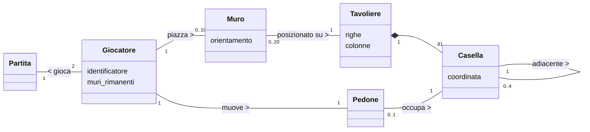
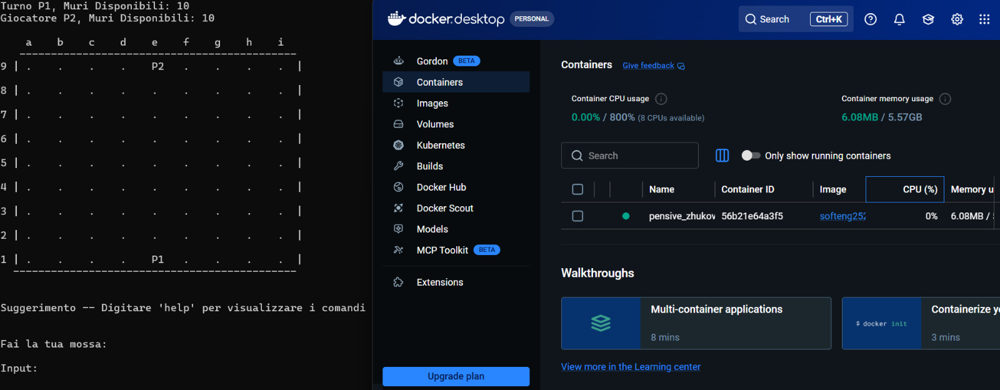
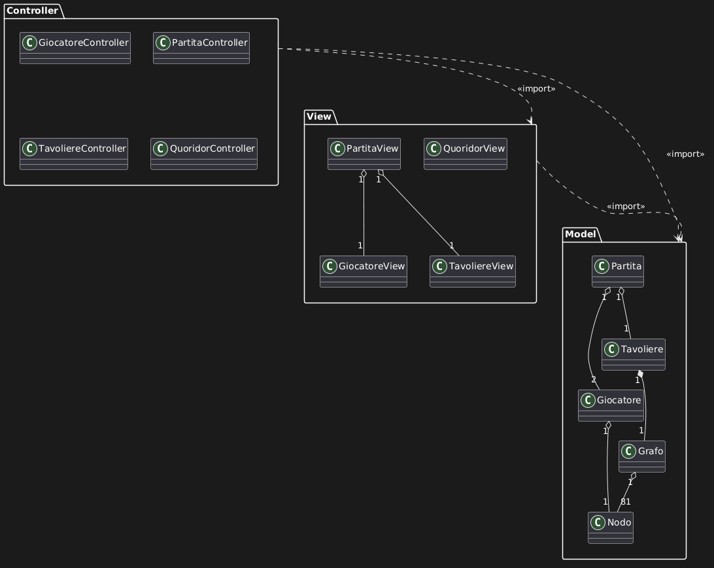
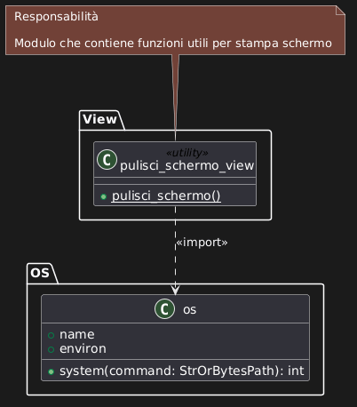

## Indice

* [1. Introduzione](#1-introduzione)
* [2. Modello di dominio](#2-modello-di-dominio)
* [3. Requisiti specifici](#3-requisiti-specifici)
  * [3.1 Requisiti funzionali](#31-requisiti-funzionali)
  * [3.2 Requisiti non funzionali](#32-requisiti-non-funzionali)
* [4. System Design](#4-system-design)
* [8. Analisi retrospettiva](#8-analisi-retrospettiva)
  * [8.1 Sprint 0](#81-sprint-0)

# Relazione Tecnica - Sprint 1 Team Stonebraker

## 1. Introduzione

Il presente documento descrive il lavoro di analisi, progettazione e sviluppo svolto dal team durante lo Sprint 1 per la realizzazione di una versione digitale del gioco da tavolo Quoridor. Quoridor è un gioco strategico in cui i giocatori (Giocatore 1 e Giocatore 2) si sfidano su una scacchiera 9x9. 

All'inizio della partita, i pedoni vengono posizionati al centro della rispettiva prima linea di partenza e a ciascun giocatore vengono assegnati 10 muri. L'obiettivo del gioco è essere il primo a far giungere il proprio pedone su una qualsiasi delle caselle della linea di fondo opposta. Durante il proprio turno, un giocatore può scegliere se muovere il proprio pedone di una casella (in orizzontale o verticale, con la possibilità di saltare l'avversario) oppure se piazzare un muro per allungare il percorso dell'avversario, prestando attenzione alla regola fondamentale che vieta di chiudere completamente ogni via d'accesso alla meta. 

L'obiettivo principale concordato per questo Sprint 1 è ottenere il "gioco base funzionante". Il team si è concentrato sull'implementazione del sottoinsieme essenziale di funzionalità (User Story) necessarie per rendere il titolo giocabile in modo minimale. Nello specifico, il rilascio di questa iterazione garantisce la visualizzazione dello stato della partita, il movimento corretto dei pedoni, il piazzamento dei muri (orizzontali e verticali), la determinazione della vittoria e la possibilità di gestire l'interruzione della partita. 

Il sistema è stato progettato come un'applicazione interattiva basata su Command Line Interface (CLI), in cui gli utenti impartiscono comandi testuali compatti (es: `e2` per il movimento o `e3h` per i muri). In conformità con i requisiti non funzionali del progetto, l'intero applicativo è stato sviluppato in Python e predisposto per essere eseguito in modo portabile all'interno di un container Docker, assicurando il pieno supporto multipiattaforma sui principali terminali (Linux, MacOS, PowerShell e Git Bash).

## 2. Modello di dominio



## 3. Requisiti specifici

### 3.1 Requisiti funzionali

#### Sprint 1

1. **Visualizzare la scacchiera**: **User Story**
   Come giocatore voglio vedere la scacchiera 9x9 con le posizioni dei pedoni e dei muri sul terminale, in modo da poter decidere la prossima mossa.

**Criteri di Accettazione**

- La scacchiera mostra una griglia 9x9 con le colonne etichettate da a a i e le righe da 1 a 9.

- Il pedone del Giocatore 1 è visualizzato nella posizione corrente con il simbolo P1, il pedone del Giocatore 2 con P2.

- Le caselle vuote sono rappresentate dal simbolo “.” (punto).

- I muri orizzontali e verticali piazzati sono visibili sulla scacchiera e distinguibili tra loro.

- Per ciascun giocatore è indicato il numero di muri ancora disponibili.

- È indicato di chi è il turno corrente.

- La scacchiera viene ristampata dopo ogni mossa valida.
2. **Muovere il pedone**: **User Story**
   Come giocatore, voglio poter muovere il mio pedone digitando le coordinate della casella di destinazione, in modo tale da avanzare verso la linea di fondo avversaria.

**Criteri di Accettazione**

- Il sistema riconosce e accetta l'input per il movimento tramite notazione testuale compatta, inserendo solo la casella di destinazione (es. `e2`)

- Il sistema convalida la mossa verificando che il pedone si sposti di una sola casella alla volta in orizzontale o in verticale

- Il sistema impedisce movimenti in diagonale (non consentiti per il movimento base)

- Il sistema verifica la presenza di ostacoli, impedendo al pedone di attraversare un muro

- Il sistema impedisce al pedone di muoversi al di fuori dei confini della griglia 9x9.

- A fronte di qualsiasi input non valido (formato errato, mossa illegale o casella occupata), il sistema rifiuta l'azione senza mai andare in crash, permettendo all'utente di riprovare

- Dopo una mossa valida, la posizione del pedone si aggiorna, la scacchiera viene ristampata e il turno passa all'avversario
3. **Piazzare un muro orizzontale**:**User Story**
   Come giocatore, voglio poter piazzare un muro orizzontale digitando le coordinate apposite, in modo tale da ostacolare e allungare il percorso del pedone avversario verso la mia linea di fondo.

**Criteri di Accettazione**

- Il sistema riconosce l'input per il piazzamento orizzontale tramite la notazione testuale a 3 caratteri (intersezione + orientamento), ad esempio `e3h`.

- Il sistema verifica che il giocatore di turno abbia ancora muri a disposizione nel proprio inventario prima di accettare la mossa.

- Il sistema impedisce di posizionare il muro al di fuori dei limiti consentiti dalla griglia della scacchiera.

- Il sistema impedisce di posizionare un muro orizzontale se l'intersezione è già occupata, evitando conflitti o sovrapposizioni con altri muri.

- A fronte di qualsiasi input non valido (sintassi errata, incrocio occupato), il sistema rifiuta passivamente l'azione senza mai andare in crash, richiedendo un nuovo inserimento.

- Dopo una mossa valida, la disponibilità dei muri del giocatore scende di 1, la scacchiera viene aggiornata e ristampata, e il turno passa all'avversario.
4. **Piazzare un muro verticale**:**User Story**
   Come giocatore, voglio poter piazzare un muro verticale digitando le coordinate apposite, in modo tale da ostacolare e allungare il percorso del pedone avversario verso la mia linea di fondo.

**Criteri di Accettazione**

- Il sistema riconosce e accetta l'input per il piazzamento verticale tramite la notazione testuale compatta a 3 caratteri (intersezione + orientamento), ad esempio `d5v`.
- Il sistema verifica che il giocatore di turno possieda ancora muri disponibili nel proprio inventario prima di convalidare la mossa.
- Il sistema impedisce di posizionare il muro al di fuori dei limiti consentiti dalla griglia 9x9.
- Il sistema impedisce di posizionare un muro verticale se la coordinata specificata è già occupata da un altro muro, evitando sovrapposizioni.
- A fronte di qualsiasi input non valido (formato errato, incrocio occupato, tentativo di blocco totale o muri esauriti), il sistema rifiuta passivamente l'azione senza mai andare in crash, permettendo all'utente di inserire un nuovo comando.
- Dopo una mossa valida, la disponibilità dei muri del giocatore di turno scende di 1, la scacchiera viene aggiornata e ristampata, e il turno passa all'avversario.
5. **Verificare la vittoria**:**User Story**
   Come giocatore, voglio che il sistema verifichi se ho raggiunto la linea di fondo avversaria e decreti la fine della partita, per poi decretare il vincitore.

**Criteri di Accettazione**

- Il sistema controlla in modo automatico la posizione dei pedoni dopo ogni mossa valida.
- Il sistema riconosce la vittoria del Giocatore 1 (P1) se il suo pedone raggiunge una qualsiasi delle 9 caselle della linea di fondo opposta (riga 9).
- Il sistema riconosce la vittoria del Giocatore 2 (P2) se il suo pedone raggiunge una qualsiasi delle 9 caselle della sua linea di fondo opposta (riga 1).
- Al raggiungimento delle condizioni di vittoria, il sistema stampa a terminale un messaggio ben visibile che dichiara ufficialmente quale giocatore ha vinto la partita.
- Dopo la dichiarazione della vittoria, il sistema interrompe il ciclo dei turni e termina correttamente la partita in corso, senza presentare errori o crash.
6. **Abbandonare la partita**:**User Story**
   Come giocatore, voglio poter interrompere e abbandonare la partita in corso in qualsiasi momento tramite un comando testuale, concedendo la vittoria al mio avversario.

**Criteri di Accettazione**

- Il sistema riconosce e accetta un comando testuale specifico per l'abbandono (es. `abbandona` o `resa`) inserito al posto delle coordinate di mossa.

- Al momento dell'inserimento del comando, e al suo invio, il sistema interrompe immediatamente il ciclo dei turni della partita corrente.

- Il sistema gestisce l'interruzione in modo controllato, chiudendo la partita e ritornando al menu principale (o uscendo dal gioco) senza mai andare in crash o generare errori imprevisti.
7. **Mostrare un messaggio di aiuto**:**User Story**
   Come giocatore, voglio poter richiedere e visualizzare un messaggio di aiuto esplicativo, in modo tale da comprendere rapidamente la sintassi corretta dei comandi necessari per giocare tramite linea di comando.

**Criteri di Accettazione**

- Il sistema riconosce e accetta un comando testuale specifico (es. `help` o `aiuto`) inserito al prompt dei comandi.

- Il sistema stampa a terminale un riepilogo chiaro e conciso della sintassi da usare per le mosse valide (es. `e2` per muovere il pedone, `e3h` o `d5v` per piazzare i muri) e per le altre azioni di gioco (es. abbandonare o uscire).

- La visualizzazione del messaggio di aiuto non avanza il turno né altera lo stato della scacchiera, permettendo al giocatore di inserire la sua mossa subito dopo.

- Le istruzioni mostrate riflettono direttamente le funzionalità della CLI, senza rimandare l'utente a file di testo esterni.

- Come per ogni altro input, un'eventuale sintassi errata nel richiamare l'aiuto viene gestita passivamente e non causa mai il crash dell'applicazione.
8. **Uscire dal gioco**:**User Story**
   Come giocatore, voglio poter uscire completamente dal gioco tramite un comando testuale, in modo tale da chiudere l'applicazione in modo sicuro e tornare al terminale.

**Criteri di Accettazione**

- Il sistema riconosce e accetta un comando testuale specifico per l'uscita (es. `esci`, `quit` o `exit`) inserito al prompt dei comandi.
- Al momento dell'inserimento del comando, l'applicazione si chiude immediatamente e in modo pulito.
- Se il comando viene inserito mentre una partita è in corso, la partita viene interrotta istantaneamente senza salvataggio.
- Il sistema gestisce l'uscita restituendo correttamente il controllo al terminale (o al container Docker) senza mai generare eccezioni non gestite o crash dell'applicazione.

### 3.2 Requisiti non funzionali

- **RNF1** (Robustezza): Il sistema deve essere eseguibile in un container **Docker**.
- **RNF2** (Portabilità): I terminali supportati devono essere: Terminal di Linux, Terminal di MacOS, PowerShell di Windows, Git Bash di Windows. 
- **RNF3** (Robustezza): Per qualunque input inaspettato l'applicazione non deve mai andare in crash.
- **RNF4** (Normalizzazione comandi): La Command Line Interface (CLI) deve accettare notazioni testuali compatte (es. `e2` per il pedone, `e3h` per i muri).
  
  ## 4. System Design
  
  ### Stile architetturale MVC
  
  > L'architettura del software è fondata sullo stile **Model-View-Controller (MVC)**, strutturata per separare nettamente le logiche di back-end dall'interfaccia utente in CLI. Ecco come sono state gestite le rispettive parti del modello:
1. **Model:** Il Model comprende i dati, la topologia del dominio e le regole del gioco, vi troviamo file come `partita.py`, `giocatore.py` o `tavoliere.py`. Il Model segue una fondamentale regola: esso è **l'unico responsabile** della validazione delle mosse. Infatti, quando un'azione viola le regole (ad esempio un piazzamento di un muro non possibile o una mossa non legale) il Model si oppone sollevando eccezioni, che sono state rigorosamente tipizzate (per citarne una: `ErrorePosizione`).
2. **Controller:** Il Controller comprende i file di controllo come `partita_controller.py` o `quoridor_controller.py`, questi fungono da intermediari tra l'esperienza dell'utente e le effettive logiche di gioco, cioè hanno la responsabilità di fare un parsing dell'input, richiamare i Model e catturare tramite dei blocchi `try...except` le eventuali eccezioni sollevate. Grazie al loro lavoro il programma non va in 'crash' ma fornisce all'utente una View specifica per l'errore.
3. **View:** La View è il livello di presentazione, vi abbiamo file come `partita_view`. Questi non hanno alcuna logica decisionale, bensì si limitano a fare stampe (es: stampare il tavoliere o messaggi di errore per l'utente) garantendo una comunicazione con l'utente in CLI e talvolta incapsulando le richieste di input mostrando i relativi errori ricevuti dal Controller.

### Principi di progettazione

#### Struttura dati

Abbiamo scelto di progettare il `Tavoliere` tramite `Grafo`. Si è infatti scelto di implementare la griglia di gioco non come una semplice matrice, ma come un **grafo basato sulle liste di adiacenze**, il Grafo è composto da oggetti `Nodo`. In particolare è un Grafo basato su un dizionario con:

- chiavi: oggetti `Nodo` (prima citati), che indicano le celle del tavoliere
- valore: lista di adiacenza, cioè liste di Nodi con i relativi riferimenti che mantengono l'informazione sulle caselle adiacenti (e accessibli) rispetto il nodo ispezionato (la chiave), abbiamo scelto anche un particolare pattern di memorizzione: *Adiacente sopra, Adiacente Sotto, Adiacente Sinistra e Adiacente Destra*. Questa scelta permette di implementare in modo elegante le regole del Quoridor, ad esempio: 
  
  > *il piazzamento di un muro da parte di un giocatore si traduce semplicemente nella rimozione dell'arco (quello del legame di adiacenza) dalla lista di adiacenza del Nodo in questione e dalla lista di adiacenza dell'altro Nodo interessato.*  

La scelta di questa struttura dati permetterà anche in futuro di implementare, per funzionalità avanzate, tramite algoritmi BFS o DFS, come verificare che un muro non blocchi completamente il percorso del giocatore.

### Gestione dei requisiti non funzionali

> L'architettura risponde ai vincoli operativi e di qualità specificati:

- **RNF1 e RNF2** Per garantire l'esecuzione uniforme sui terminali richiesti, azzerando i conflitti legati agli OS, il software è incapsulato in un container **Docker**. Di seguito si riporta una prova del corretto funzionamento del sistema all'interno del container **Docker**, per confermarne la portabilità:
  
- **RNF3:** Per qualunque input l'applicazione non va in crash, questo è stato garantito, a livello architetturale nel nostro software, attraverso una rigida regola interna nel nostro pattern MVC: le classi del `Model` si occupano di validare i dati e si limitano a sollevare eccezioni (che sono personalizzate e tipizzate) in caso di mosse non valide. Invece i `Controller` hanno la responsabilità di catturarle con blocchi `try...except` delegando alla `View` il compito di stampare il messaggio di errore.
- **RNF4** Il sistema garantisce l'interazione tramite CLI inoltre l'azione viene dedotta unicamente dalla sintassi testuale compatta, fornita in input secondo una griglia 9x9. Il `Controller` differenzia inoltre un movimento dal piazzamento di un muro.

### Diagrammi

#### Diagramma dei package



#### Diagramma dei componenti



## 5. OO Design

### Le nostre scelte

#### Traduzione del modello di dominio (**forward engineering**)

Nel nostro progetto, la transizione dal Modello di Dominio all'implementazione software rispetta rigorosamente i principi dell'Object-Oriented Design, tenendo conto che un diagramma concettuale non impone una traduzione 1:1 in termini di classi strutturali. Ad esempio, nel modello di dominio è presente il `Pedone` come una **classe concettuale** che nel software è stato implementato sotto forma di stato interno incapsulato all'interno della classe Giocatore (tramite la sua posizione). Poiché la responsabilità del pedone è legata unicamente alla sua posizione sui nodi del Grafo, la creazione di una classe dedicata Pedone avrebbe aumentato la complessità senza aggiungere logica di business significativa. Pertanto, si è scelto di mantenere questo dato come attributo riservato del Giocatore, nascondendo i dettagli implementativi all'esterno.L'esistenza e la posizione del pedone non sono mai definite in modo implicito nella CLI; al contrario, risiedono in modo autorevole e univoco all'interno del livello Model. La View si limita esclusivamente ad assolvere al suo ruolo di "impiattamento": essa interroga lo stato spaziale fornito dal Giocatore (Model) e lo traduce visivamente sul terminale stampando i simboli 'P1' o 'P2'. In questo modo, abbiamo garantito il totale isolamento della logica di dominio dall'interfaccia utente, impedendo che informazioni di business vengano gestite dallo strato di presentazione. Una simile traduzione è stata fatta per i muri che non trovano una corrispondenza diretta con una classe software ma solo nelle logiche di gioco.

#### Gestione del sistema

> Il sistema è stato disegnato per limitare il debito tecnico e facilitare la sua manutenzione, applicando i seguenti principi:

- **Presentazione separata:** *Nessuna istruzione di I/O risiede nel model, il dominio di gioco è totalmente ignaro dell'interfaccia CLI, il che permetterebbe in futuro di modificare l'interfaccia testuale senza dover modificare le logiche di gioco.*
- **Alta coesione e Basso Accoppiamento:** *Le responsabilità sono state distribuite assegnandole in modo tale da limitare l'impatto dei cambiamenti e ottenere classi con compiti ben definiti, ad esempio `Tavoliere` gestisce solo la struttura spaziale del grafo, mentre `Partita` orchestra il flusso dei turni, evitando che una modifica ad un componente si propaghi agli altri.*
- **Information Hiding:** *Ogni componente custodisce dati privati al suo interno, questi sono di fatto incapsulati garantendo uno stato 'segreto' con variabili di istanza private accessibili solo tramite metodi specifici, i dettagli implementativi sono quindi nascosti all'esterno.*

### Principio DRY

Il principio DRY è stato applicato in diverse parti del progetto

1. #### Funzione `chiedi_input_utente()`
   
   1. In diversi momenti nel gioco è necessario richiedere un input da parte dell'utente. Dato che la struttura delle richieste di input è pressoché identica in tutti i momenti del gioco (Vengono stampate delle indicazioni e successivamente viene richiesto l'input), per evitare ripetizioni è stato applicato il principio DRY, creando una funzione a disposizione di tutte le view nel file `funzioni_utili_stampa.py`

2. #### Ciclo Principale Partita
   
   1. Per giocare una partita, sono state pensate diverse soluzioni, riguardanti il metodo `gioca_partita()`:
      
      ```python
      # Soluzione 1
      def gioca_partita_con_timer()
      def gioca_partita_no_Timer()
      
      
      # Soluzione 2
      def gioca_partita() {
          ...
          if giocatore.ha_timer()
              # Tieni conto del tempo
          ...
      }
      ```
      
      Nel primo caso verrebbe violato il principio DRY, in quanto la maggior parte del codice verrebbe ripetuto per entrambe le funzioni, con la sola differenza che in una delle due funzioni viene sottratto anche tempo al giocatore.
      
      La seconda soluzione invece controlla ad ogni ciclo se il giocatore ha un timer, e in questo caso tiene conto del tempo iniziale e finale, e dopo ogni mossa lo sottrae al giocatore col turno corrente.

## 8. Analisi retrospettiva

### 8.1 Sprint 0

Al termine dello Sprint 0, il team si è riunito per effettuare il meeting di revisione del processo (Sprint Retrospective). La discussione si è concentrata sull'efficienza del nostro metodo di lavoro e della collaborazione interna.

**Analisi del processo:**

* **Cosa ha funzionato:** *Siamo stati in grado di lavorare insieme effettuando review precise e controllando il lavoro in modo puntuale.*
* **Aree di riflessione:** *Abbiamo notato che scegliere di impostare un numero di approvazioni minime per una PR potrebbe motivare i membri del team a svolgere un buon lavoro e migliorare l'intesa, inoltre avere nomi non standardizzati di branch e PR potrebbe rendere la lettura 'difficile' talvolta.* 

**Sintesi delle azioni correttive (Miglioramenti per lo Sprint 1):**
Pur non avendo riscontrato criticità, per ottimizzare ulteriormente il lavoro in questo Sprint 1 il team ha deciso di intraprendere le seguenti azioni organizzative:

1. Mantenere l'approccio proattivo utilizzato finora.
2. Inserire label descrittive.
3. Standardizzare i nomi delle Issue e PR.
4. Aumentare ancor di più la comunicazione tra i membri del team.

**Lavagna di Retrospettiva**

> Segue una foto della lavagna utilizzata durante il meeting dal team:
> 
