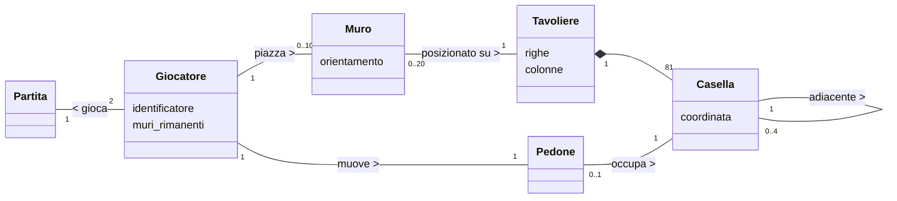

## Indice
* [1. Introduzione](#1-introduzione)
* [2. Modello di dominio](#2-modello-di-dominio)
* [3. Requisiti specifici](#3-requisiti-specifici)
    * [3.1 Requisiti funzionali](#31-requisiti-funzionali)
    * [3.2 Requisiti non funzionali](#32-requisiti-non-funzionali)
* [4. System Design](#4-system-design)
* [8. Analisi retrospettiva](#8-analisi-retrospettiva)
    * [8.1 Sprint 0](#81-sprint-0)

# Relazione Tecnica - Sprint 1 Team Stonebraker 

## 1. Introduzione
Il presente documento descrive il lavoro di analisi, progettazione e sviluppo svolto dal team durante lo Sprint 1 per la realizzazione di una versione digitale del gioco da tavolo Quoridor. Quoridor è un gioco strategico in cui i giocatori (Giocatore 1 e Giocatore 2) si sfidano su una scacchiera 9x9. 

All'inizio della partita, i pedoni vengono posizionati al centro della rispettiva prima linea di partenza e a ciascun giocatore vengono assegnati 10 muri. L'obiettivo del gioco è essere il primo a far giungere il proprio pedone su una qualsiasi delle caselle della linea di fondo opposta. Durante il proprio turno, un giocatore può scegliere se muovere il proprio pedone di una casella (in orizzontale o verticale, con la possibilità di saltare l'avversario) oppure se piazzare un muro per allungare il percorso dell'avversario, prestando attenzione alla regola fondamentale che vieta di chiudere completamente ogni via d'accesso alla meta. 

L'obiettivo principale concordato per questo Sprint 1 è ottenere il "gioco base funzionante". Il team si è concentrato sull'implementazione del sottoinsieme essenziale di funzionalità (User Story) necessarie per rendere il titolo giocabile in modo minimale. Nello specifico, il rilascio di questa iterazione garantisce la visualizzazione dello stato della partita, il movimento corretto dei pedoni, il piazzamento dei muri (orizzontali e verticali), la determinazione della vittoria e la possibilità di gestire l'interruzione della partita. 

Il sistema è stato progettato come un'applicazione interattiva basata su Command Line Interface (CLI), in cui gli utenti impartiscono comandi testuali compatti (es: `e2` per il movimento o `e3h` per i muri). In conformità con i requisiti non funzionali del progetto, l'intero applicativo è stato sviluppato in Python e predisposto per essere eseguito in modo portabile all'interno di un container Docker, assicurando il pieno supporto multipiattaforma sui principali terminali (Linux, MacOS, PowerShell e Git Bash).
## 2. Modello di dominio

## 3. Requisiti specifici
### 3.1 Requisiti funzionali
1. Visualizzare la scacchiera
2. Muovere il pedone
3. Piazzare un muro orizzontale
4. Piazzare un muro verticale
5. Verificare la vittoria
6. Abbandonare la partita
7. Mostrare un messaggio di aiuto
8. Uscire dal gioco
### 3.2 Requisiti non funzionali
- Il sistema deve essere eseguibile in un container **Docker**.
- I terminali supportati devono essere: Terminal di Linux, Terminal di MacOS, PowerShell di Windows, Git Bash di Windows. 
- **Robustezza:** Per qualunque input inaspettato l'applicazione non deve mai andare in crash.
- La Command Line Interface (CLI) deve accettare notazioni testuali compatte (es. `e2` per il pedone, `e3h` per i muri).
## 4. System Design
### Stile architetturale MVC
> L'architettura del software è fondata sullo stile **Model-View-Controller (MVC)**, strutturata per separare nettamente le logiche di back-end dall'interfaccia utente in CLI. Ecco come sono state gestite le rispettive parti del modello:
1. **Model:** Il Model comprende i dati, la topologia del dominio e le regole del gioco, vi troviamo file come `partita.py`, `giocatore.py` o `tavoliere.py`. Il Model segue una fondamentale regola: esso è **l'unico responsabile** della validazione delle mosse. Infatti, quando un'azione viola le regole (ad esempio un piazzamento di un muro non possibile o una mossa non legale) il Model si oppone sollevando eccezioni, che sono state rigorosamente tipizzate (per citarne una: `ErrorePosizione`).
2. **Controller:** Il Controller comprende i file di controllo come `partita_controller.py` o `quoridor_controller.py`, questi fungono da intermediari tra l'esperienza dell'utente e le effettive logiche di gioco, cioè hanno la responsabilità di fare un parsing dell'input, richiamare i Model e catturare tramite dei blocchi `try...except` le eventuali eccezioni sollevate. Grazie al loro lavoro il programma non va in 'crash' ma fornisce all'utente una View specifica per l'errore.
3. **View:** La View è il livello di presentazione, vi abbiamo file come `partita_view`. Questi non hanno alcuna logica decisionale, bensì si limitano a fare stampe (es: stampare il tavoliere o messaggi di errore per l'utente) garantendo una comunicazione con l'utente in CLI e talvolta incapsulando le richieste di input mostrando i relativi errori ricevuti dal Controller.

### Principi di progettazione
#### Struttura dati
Abbiamo scelto di progettare il `Tavoliere` tramite `Grafo`. Si è infatti scelto di implementare la griglia di gioco non come una semplice matrice, ma come un **grafo basato sulle liste di adiacenze**, il Grafo è composto da oggetti `Nodo`. In particolare è un Grafo basato su un dizionario con:
- chiavi: oggetti `Nodo` (prima citati), che indicano le celle del tavoliere
- valore: lista di adiacenza, cioè liste di Nodi con i relativi riferimenti che mantengono l'informazione sulle caselle adiacenti (e accessibli) rispetto il nodo ispezionato (la chiave), abbiamo scelto anche un particolare pattern di memorizzione: *Adiacente sopra, Adiacente Sotto, Adiacente Sinistra e Adiacente Destra*. Questa scelta permette di implementare in modo elegante le regole del Quoridor, ad esempio: 
> *il piazzamento di un muro da parte di un giocatore si traduce semplicemente nella rimozione dell'arco (quello del legame di adiacenza) dalla lista di adiacenza del Nodo in questione e dalla lista di adiacenza dell'altro Nodo interessato.*  

La scelta di questa struttura dati permetterà anche in futuro di implementare, per funzionalità avanzate, tramite algoritmi BFS o DFS, come verificare che un muro non blocchi completamente il percorso del giocatore.
#### Gestione del sistema
> Il sistema è stato disegnato per limitare il debito tecnico e facilitare la sua manutenzione, applicando i seguenti principi:
- **Presentazione separata:** *Nessuna istruzione di I/O risiede nel model, il dominio di gioco è totalemnte ignaro dell'interfaccia CLI, il che permetterebbe in futuro di modificare l'interfaccia testuale senza dover modificare le logiche di gioco.*
- **Alta coesione e Basso Accoppiamento:** *Le responsabilità sono state distribuite assegnandole in modo tale da limitare l'impatto dei cambiamenti e ottenere classi con compiti ben definiti, ad esempio `Tavoliere` gestisce solo la struttura spaziale del grafo, mentre `Partita` orchestra il flusso dei turni, evitando che una modifica ad un componente si propaghi agli altri.*
- **Information Hiding:** *Ogni componente custodisce dati privati al suo interno, questi sono di fatto incapsulati garantendo uno stato 'segreto' con variabili di istanza private accessibili solo tramite metodi specifici, i dettagli implementativi sono quindi nascosti all'esterno.*
### Gestione dei requisiti non funzionali e vincoli
> L'architettura risponde ai vincoli operativi e di qualità specificati:
- **Vincolo di tolleranza ai guasti:** Per qualunque input l'applicazione non va in crash, questo è stato garantito, a livello architetturale nel nostro software, attraverso una rigida regola interna nel nostro pattern MVC: le classi del `Model` si occupano di validare i dati e si limitano a sollevare eccezioni (che sono personalizzate e tipizzate) in caso di mosse non valide. Invece i `Controller` hanno la responsabilità di catturarle con blocchi `try...except` delegando alla `View` il compito di stampare il messaggio di errore.
- **Vincolo di usabilità CLI (notazione compatta):** Il sistema garantisce l'interazione tramite CLI inoltre l'azione viene dedotta unicamente dalla sintassi testuale compatta, fornita in input secondo una griglia 9x9. Il `Controller` differenzia inoltre un movimento dal piazzamento di un muro.
- **Vincolo di portabilità multi-piattaforma:** Per garantire l'esecuzione uniforme sui terminali richiesti, azzerando i conflitti legati agli OS, il software è incapsulato in un container **Docker**.
## 8. Analisi retrospettiva
### 8.1 Sprint 0
Al termine dello Sprint 0, il team si è riunito per effettuare il meeting di revisione del processo (Sprint Retrospective). La discussione si è concentrata sull'efficienza del nostro metodo di lavoro e della collaborazione interna.

**Analisi del processo:**
*   **Cosa ha funzionato:** *Siamo stati in grado di lavorare insieme effettuando review precise e controllando il lavoro in modo puntuale.*
*   **Aree di riflessione:** *Abbiamo notato che scegliere di impostare un numero di approvazioni minime per una PR potrebbe motivare i membri del team a svolgere un buon lavoro e migliorare l'intesa, inoltre avere nomi non standardizzati di branch e PR potrebbe rendere la lettura 'difficile' talvolta.* 

**Sintesi delle azioni correttive (Miglioramenti per lo Sprint 1):**
Pur non avendo riscontrato criticità, per ottimizzare ulteriormente il lavoro in questo Sprint 1 il team ha deciso di intraprendere le seguenti azioni organizzative:
1. Mantenere l'approccio proattivo utilizzato finora.
2. Inserire label descrittive.
3. Standardizzare i nomi delle Issue e PR.
4. Aumentare ancor di più la comunicazione tra i membri del team.

**Lavagna di Retrospettiva**
> Segue una foto della lavagna utilizzata durante il meeting dal team:

